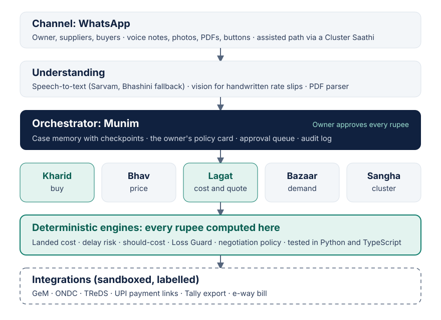

# BhavSetu (भाव सेतु, "price bridge")

[](https://github.com/OWNER/bhavsetu/actions/workflows/ci.yml)

**A voice-first team of AI agents on WhatsApp that picks the best supplier for each order and never lets a small factory quote below cost.**

Tech4Bharat 2026 · Problem 4.1 (Small factories overpay for raw material and quote orders at a loss) · Agentic AI track

**Live site:** https://bhavsetu.vercel.app · Try a purchase, change the quotes, run Loss Guard on a job.

---

## The problem

Owners of fabrication, plastics, garment and component units collect rates by phone and WhatsApp, compare them on paper, miss freight, loading and credit costs, and quote orders by rule of thumb while running the shop floor. Indian MSMEs buy about ₹124.9 trillion of inputs a year, only 30–40% through digital channels, and owners make 64.5% of purchase decisions themselves. Hot-rolled steel went from about ₹46,600/t (Jan 2025) to about ₹62,000/t (Oct 2026). Sources are listed on the site and in [`apps/web/content/sources.json`](apps/web/content/sources.json).

## What BhavSetu does

The owner speaks a need in Kannada, Hindi or English. An orchestrator, **Munim**, plans the case and hands work to five agents:

| Agent | Job |
| --- | --- |
| **Kharid** (buy) | Sends RFQs, reads replies, computes landed cost and delay risk, negotiates inside the owner's limits, raises the PO after approval |
| **Bhav** (price) | Tracks benchmarks, flags overpriced quotes, says buy now or wait |
| **Lagat** (cost) | Turns a buyer's drawing or voice spec into a should-cost and a protected quote; runs Loss Guard |
| **Bazaar** (demand) | Finds buyer enquiries on GeM, ONDC and lead lists |
| **Sangha** (cluster) | Pools demand from neighbouring units for group buys |

The language model handles language; **every rupee is computed by deterministic, unit-tested code**. Only the owner awards, commits or pays.



## Real vs simulated (website v1)

| Real and tested | Simulated with sample data |
| --- | --- |
| Landed-cost, delay-risk, Loss Guard and savings engines in Python and TypeScript | WhatsApp, supplier and owner conversations |
| 26 tests on one shared set of vectors (`tests/vectors.json`), run on every push | Speech and vision confidence scores in the trace |
| Every number in the site's calculators and simulator, computed live by the engines | GeM, ONDC, TReDS and payment integrations (planned, sandboxed and labelled) |

All people and company names in the demo are fictional. See [`docs/mock-disclosure.md`](docs/mock-disclosure.md).

## The maths

```
Landed     = q·p + freight + loading + (no GST credit ? GST·q·p : 0) − q·p·r·(credit days / 365)
Need-by    = customer date − production days − buffer days
s          = need-by − promised date
Delay days = −s + (1 − on-time)·slip          if s < 0  (misses deadline: never recommended)
           = (1 − on-time)·max(0, slip − s)   if s ≥ 0
Effective  = Landed + Delay days × cost of one day's delay
```

Worked example (2 t of 2 mm MS sheet, need by 14 Nov, ₹6,000 per day of delay): the cheapest rate (₹62,400) arrives three days late, effective ₹1,47,800; a ₹63,500 supplier carries ₹9,600 of delay risk, effective ₹1,40,600; the ₹65,000 supplier is on time, effective ₹1,34,500, and is recommended.

Loss Guard example: 500 brackets cost ₹88,391.66 in full (₹176.78 a piece) including 60 days of waiting to be paid; a ₹170 quote loses ₹3,392, so it is blocked, and the minimum safe price at 8% margin is ₹190.93.

## Repository

```
apps/web/                 Next.js site (Vercel root directory)
  app/                    layout, page, Open Graph image, icon
  components/             Hero, PurchaseSimulator, SupplierCalculator, LossGuard, SavingsCalculator, Sections
  content/                every word and number on the page, as JSON, validated with Zod at build time
  lib/engines/            TypeScript engines + Vitest tests
  scripts/prelaunch.mjs   fails if links, names or the deck are missing, or a [placeholder] remains
packages/engines/         Python engines + pytest tests
tests/vectors.json        single source of truth for both test suites
docs/                     architecture, mock disclosure, research, field-notes template
.github/workflows/ci.yml  pytest, type-check, Vitest and build on every push
```

## Quickstart

```bash
# Website
cd apps/web
npm install
npm run dev            # http://localhost:3000
npm test               # Vitest: engines against tests/vectors.json
npm run build

# Python engines
pip install pytest
pytest packages/engines
```

To change any text, number or link, edit the JSON in `apps/web/content/`. A typo fails the build rather than the page.

## Deploy on Vercel

1. Import this repo in Vercel.
2. Set **Root Directory** to `apps/web`. Keep the detected Next.js settings.
3. Name the project `bhavsetu` (or `bhavsetu-t4b` if taken). If the URL differs, update `siteUrl` in `apps/web/content/site.json`.
4. Turn on Web Analytics for the project.
5. Every push to `main` deploys to production; every pull request gets a preview URL.

## Team

| Role | Owns |
| --- | --- |
| A: Agent lead | Munim orchestrator, Kharid and Lagat agents |
| B: Engines and data | Landed cost, delay risk, Loss Guard, evaluation |
| C: Channel and experience | WhatsApp, speech, this website |
| D: Field and business | Interviews, pilots, business model, deck |

## Licence

MIT, unless the organisers' IP terms say otherwise.
