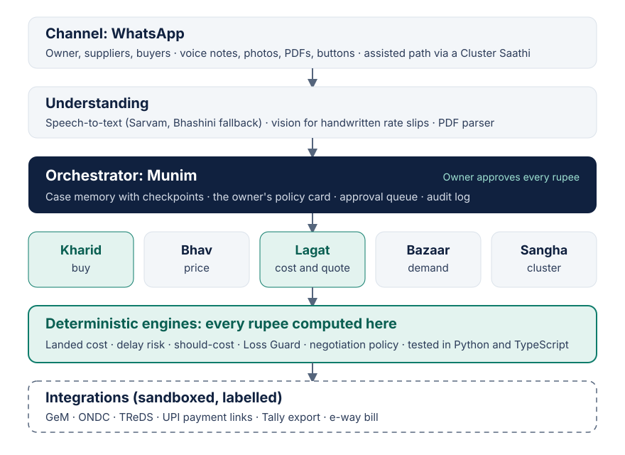

# Architecture

BhavSetu is a graph of agents with checkpointed state. The language model handles language and judgment; plain code handles every rupee.

## Layers

1. **Channel.** WhatsApp Business Cloud API for owners, suppliers and buyers: voice notes, photos, PDFs, buttons. An assisted path through a Cluster Saathi at a JanAI Café or association office.
2. **Understanding.** Speech-to-text for code-mixed Kannada, Hindi, Tamil, Telugu and English (Sarvam; Bhashini fallback); a vision model for handwritten rate slips; a PDF parser for typed quotes and drawings.
3. **Orchestrator: Munim.** Holds the case memory, the owner's policy card (ceilings, rounds, credit terms, approved suppliers) and the approval queue. Writes an audit log of every step.
4. **Agents.** Kharid (buy), Bhav (price), Lagat (cost and quote), Bazaar (demand), Sangha (cluster).
5. **Deterministic engines.** Landed cost, delay risk, should-cost, Loss Guard, negotiation policy. Unit-tested; the same test vectors run in Python and TypeScript.
6. **Integrations.** GeM, ONDC, TReDS, UPI payment links, Tally export, e-way bill. Sandboxed and labelled until real access exists.

## Agentic properties (the organisers' definition)

| The brief asks for | How BhavSetu does it |
| --- | --- |
| Pursues a goal over many steps | Munim plans RFQ → collect → compare → negotiate → recommend → PO → track |
| Plans and acts in external systems | WhatsApp messages, price benchmarks, GeM bids, PO documents |
| Keeps memory of the case | Checkpointed state per case: suppliers, quotes, rounds, limits, history |
| Recovers when something fails | Confirms unclear fields, reminds silent suppliers, widens the RFQ, falls back to a second model |
| Seeks approval before money moves | Hard gates on award, PO, quote to a buyer, payment and data sharing |

## Guardrails

- The agent negotiates and recommends; only the owner awards, commits or pays.
- Negotiation stays inside the owner's floor and ceiling, never invents a competing offer, never reveals a rival's price.
- A supplier who cannot deliver before the need-by date is shown but never recommended.
- No quote below the Loss Guard floor leaves without a logged override reason.
- First contact discloses that BhavSetu is an AI assistant acting for the named unit, with an opt-out.
- "Ruko" or "stop" freezes every open case.
- Minimum data, consent per purpose, deletable on request (DPDP Act, 2023).

## Planned stack (from week 2)

FastAPI + LangGraph in `apps/agent/`, Postgres (cases, quotes, approvals, audit log), Redis queue, object storage for media, Langfuse or OpenTelemetry traces rendered as the trace panel.
